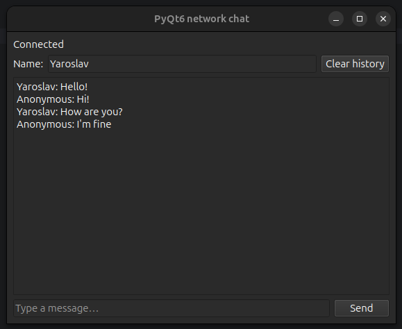
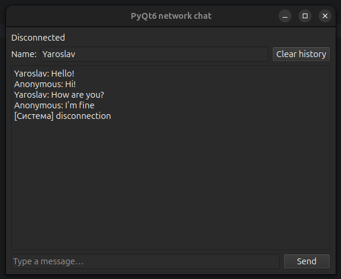

# pyqt-threads

## Задание 1. Обработка потери соединения

**`ReceiveThread`:**

- В `run()` добавлен `try/except OSError` вокруг `self.net.recv()`. При сетевой ошибке поток не падает, а эмитит сигнал `message_received` с системным сообщением `{"type": "system", "text": "disconnection"}` завершает цикл.
- Случай штатного закрытия соединения (когда `recv()` возвращает `None`, без исключения) обрабатывается отдельно: поток также эмитит сигнал об отключении и выходит из цикла.
- Вся информация передаётся через `pyqtSignal`.

**`MainWindow`:**

- В `handle_message()` добавлена ветка для `type == "system"`: при `text == "disconnection"` вызывается `set_disconnect()` и в историю пишется `[Система] Соединение потеряно`.

## Задание 2. Корректное завершение `SendThread`

**`SendThread`:**

- Добавлен метод `stop()`, который кладёт `None` в существующую очередь `self.queue`. Именно это передаётся в `queue.get()`.
- При получении `None` цикл прерывается, поток корректно завершается.

**`main()`:**

- После `app.exec()` вызывается `window.send_thread.stop()`, затем `window.send_thread.wait(1000)` — поток получает команду остановки через очередь и завершается в пределах таймаута.
- Сокет закрывается через `shutdown(SHUT_RDWR)` в `try/except OSError` + `close()`.

## Задание 3. Индикатор состояния подключения

- В интерфейсе уже был `QLabel` (`self.status_label`) с текстом `Connected to 127.0.0.1:50505` — он используется как индикатор.
- При успешном подключении (в конструкторе `MainWindow`) выставляется `Connected`.
- При потере соединения через сигнал `message_received` -> `handle_message()` -> `set_disconnect()` индикатор меняется на `Disconnected`.
  

## Скриншоты

**Работающий чат (состояние Connected):**

**После остановки сервера (состояние Disconnected):**

